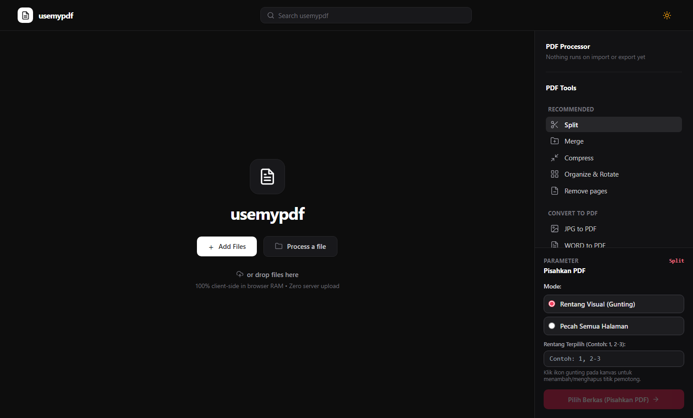
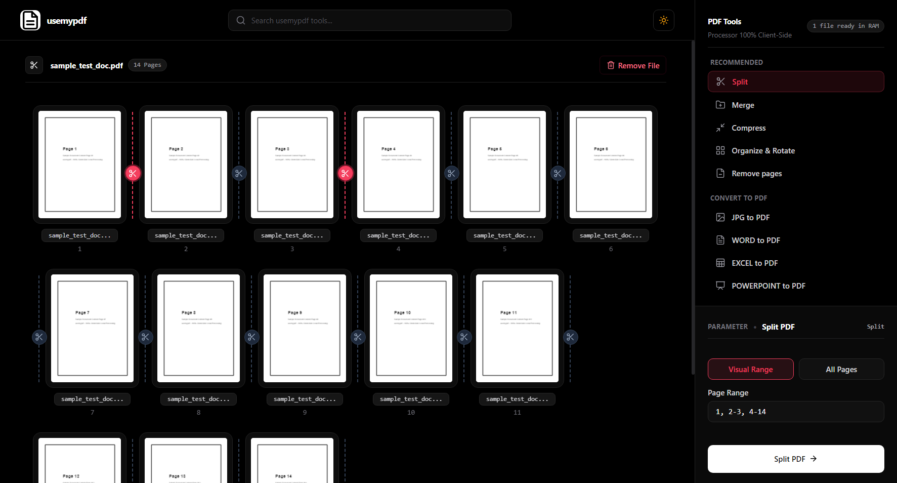

# usemypdf - Zero-Upload Client-Side PDF Suite

<p align="center">
  
</p>

<p align="center">
  
  
  
  
</p>

Aplikasi web pengolah PDF dan konversi dokumen modern, ultra-privat, dan aman dengan arsitektur **Zero-Upload** dan **Zero-Footprint** (100% Client-Side). Mengadopsi estetika gelap minimalis (*OpenAI / Vercel Dark Theme*), menggunakan ikon vektor (*Lucide Icons*), dan seluruh pemrosesan dieksekusi langsung di memori RAM browser laptop/ponsel Anda tanpa biaya server atau risiko kebocoran data.

---

## 📸 Workspace Canvas Preview

<p align="center">
  
</p>

---

## Fitur Utama

1. **Zero-Upload & 100% Client-Side Privacy (RAM Only):**
   * Seluruh berkas (PDF, Gambar, Word, Excel, PowerPoint) diproses langsung di memori browser perangkat Anda menggunakan Web APIs, PDF-Lib, PDF.js, dan SheetJS.
   * Berkas tidak pernah diunggah, disimpan, atau dikirim ke server pihak ketiga mana pun.
   * Menutup tab browser atau menghapus berkas akan membersihkan data dari memori RAM secara permanen.
   * Popover balon informasi privasi SMS minimalis dengan penunjuk tombol guard yang presisi.

2. **Organize & Edit PDF:**
   * **Split PDF**: Ekstraksi rentang halaman (*Visual Range*) atau pemisahan seluruh halaman menjadi dokumen terpisah.
   * **Merge PDF**: Menggabungkan banyak dokumen PDF menjadi satu dengan pratinjau kartu sampul (*cover card*) dan fitur *drag-and-drop* pengurutan yang intuitif.
   * **Organize & Rotate**: Mengatur orientasi dan memutar halaman dokumen (90° CW, 180°, 270° CCW) secara visual.
   * **Remove Pages**: Menyeleksi dan menghapus halaman yang tidak diinginkan secara visual dengan 1 klik.

3. **Kompresi Cerdas Berbobot Ringan (PDF Optimizer):**
   * Mesin optimasi adaptif dua tingkat (*dual-tier adaptive engine*) dengan pembersihan struktur stream dan kalkulasi resolusi otomatis.
   * 3 Tingkat kompresi: *Extreme*, *Recommended*, dan *Less Compression*.
   * Tampilan estimasi ukuran berkas langsung (*Live Estimated Output Size*) yang akurat.
   * Fitur pelindung (*Strict Size Guard*): Ukuran hasil kompresi dijamin tidak akan pernah membengkak melampaui ukuran asli berkas.

4. **Konversi Dokumen Lengkap (Office & Image):**
   * **PDF to JPG / PNG**: Render resolusi tinggi (*Standard*, *HD*, *Ultra HD*) dengan unduhan otomatis format ZIP untuk multi-halaman.
   * **JPG / PNG to PDF**: Mengubah kumpulan gambar menjadi dokumen PDF standar dengan pilihan tata letak halaman (*A4*, *Fit to Image*, *Letter*).
   * **Office ke PDF (Word, Excel, PowerPoint)**: Konversi berkas `.docx`, `.xlsx`, dan `.pptx` langsung di browser dengan tata letak bersih.
   * **PDF ke Office (Word, Excel, PowerPoint)**: Ekstrak teks dan baris tabel PDF menjadi dokumen Office siap pakai.

5. **Antarmuka Minimalis & Kemudahan Penggunaan:**
   * Tampilan modern minimalis bergaya Vercel / OpenAI dengan dukungan penuh Tema Gelap & Terang (*Dark / Light Mode*).
   * Navigasi cepat dengan pencarian alat *real-time* dan pintasan keyboard (`Ctrl+K` / `⌘K`).
   * Panel parameter yang terkunci otomatis sebelum berkas dimuat untuk mencegah kesalahan konfigurasi (*Zero Misfires*).
   * Ringan dan instan: Dibangun dengan CSS statis hasil *compile* (~30KB) tanpa dependensi runtime berat.

---

## 🛠 Matriks Alat & Kemampuan (13 Tools)

| Kategori | Alat | Input | Output | Keterangan |
| :--- | :--- | :--- | :--- | :--- |
| **Atur Dokumen** | **Split PDF** | `.pdf` | `.pdf` (Single / ZIP) | Ekstraksi range halaman custom |
| | **Merge PDF** | Multi `.pdf` | `.pdf` | Drag & drop susun urutan file |
| | **Organize & Rotate** | `.pdf` | `.pdf` | Rotasi sudut halaman visual |
| | **Remove Pages** | `.pdf` | `.pdf` | Hapus halaman tak diinginkan |
| **Optimasi** | **Compress PDF** | `.pdf` | `.pdf` | Dual-tier size guard kompresi |
| **Konversi ke PDF** | **JPG / PNG to PDF**| Multi Gambar | `.pdf` | A4 / Letter / Fit layout |
| | **Word to PDF** | Multi `.docx` | `.pdf` | Parsing XML dokumen langsung |
| | **Excel to PDF** | Multi `.xlsx, .xls` | `.pdf` | Landscape A4 auto table grid |
| | **PPT to PDF** | Multi `.pptx` | `.pdf` | 16:9 Slide layout parsing |
| **Ekstrak dari PDF** | **PDF to JPG / PNG**| `.pdf` | `.jpg, .png` (ZIP) | Standard / HD / Ultra HD |
| | **PDF to Word** | `.pdf` | `.docx` | Ekstraksi teks & perataan |
| | **PDF to Excel** | `.pdf` | `.xlsx` | Deteksi koordinat kolom & baris |
| | **PDF to PPT** | `.pdf` | `.pptx` | Render visual slide presentasi |

---

## ⚡ Arsitektur & Performa Klien

* **Zero-Upload**: Dokumen Anda tidak pernah meninggalkan komputer Anda. Semua pemrosesan data dilakukan melalui browser engine.
* **Smart Memory Management**: Canvas GPU dibebaskan seketika (`width = 0; height = 0`) setelah render selesai untuk mencegah *memory leak*.
* **On-Demand Lazy Loading**: Modul berat seperti SheetJS (800KB) hanya dimuat saat alat Excel digunakan, membuat *initial load* halaman sangat cepat (< 50KB total payload).
* **Pre-compiled CSS**: Menggunakan Tailwind CSS statis 30KB yang bersih tanpa runtime script CDN compiler.

---

## Cara Menjalankan Aplikasi

Cukup buka file [`index.html`](index.html) langsung di browser Anda (Google Chrome, Microsoft Edge, Firefox, Brave, Safari, dll.). Tidak diperlukan server lokal, backend, atau instalasi package Node.js tambahan!

```bash
# Clone repositori
git clone https://github.com/Dytmenn/usemypdf.git

# Masuk ke direktori
cd usemypdf

# Buka index.html di browser favorit Anda
start index.html # Windows
open index.html  # macOS
xdg-open index.html # Linux
```

---

## Deployment

Aplikasi ini 100% statis dan siap di-deploy secara instan ke platform hosting statis seperti [Vercel](https://vercel.com), GitHub Pages, atau Cloudflare Pages:

* **Live Demo:** [https://usemypdf.vercel.app](https://usemypdf.vercel.app)
* **Target Repositori:** [https://github.com/Dytmenn/usemypdf](https://github.com/Dytmenn/usemypdf)

---

## Lisensi & Privasi

Proyek ini dirilis untuk kenyamanan dan keamanan pengguna. Anda memiliki kendali penuh atas dokumen Anda—karena dalam arsitektur **usemypdf**, server kami bahkan tidak pernah mengetahui dokumen apa yang sedang Anda proses.
